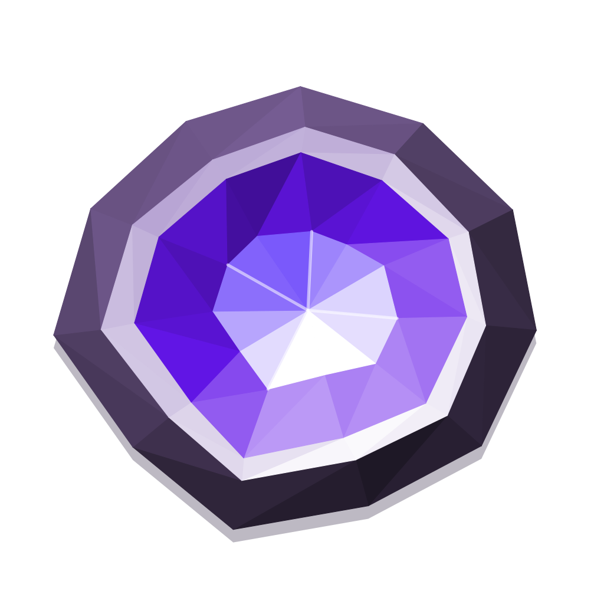
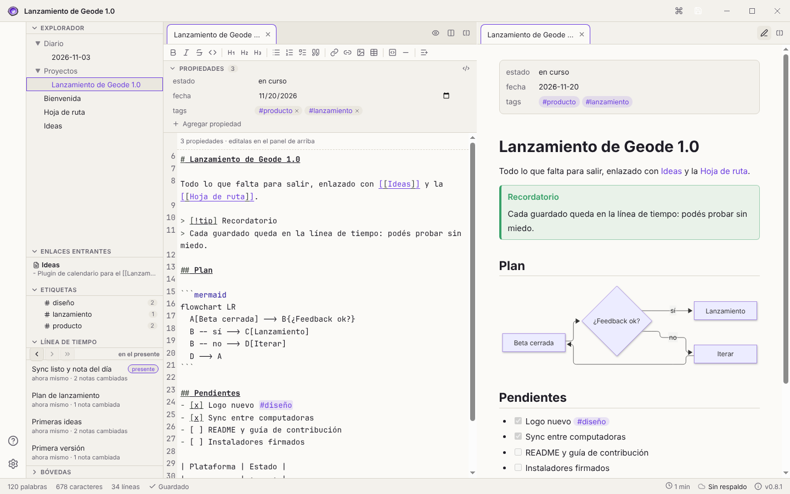
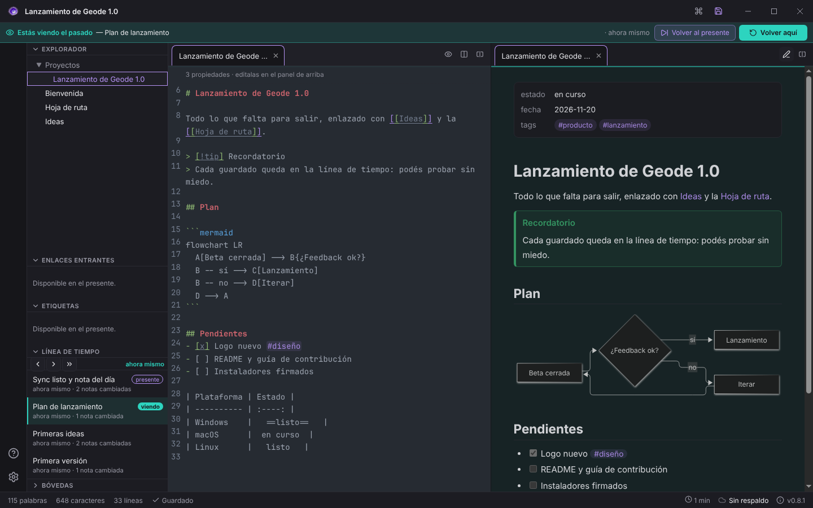
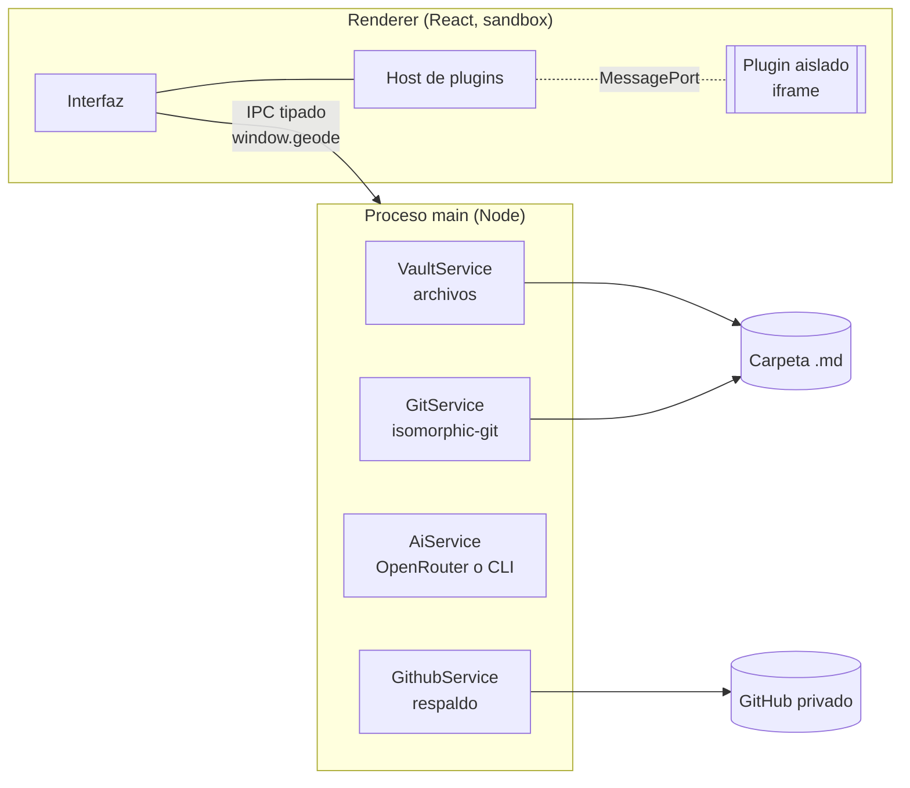

<div align="center">



# Geode

**Notas en Markdown que nunca se pierden.**<br/>
Una app de notas local-first con historial automático: escribí, probá y volvé atrás sin miedo.

[](https://github.com/chewax/geode/actions/workflows/ci.yml)
[](LICENSE)
[](CHANGELOG.md)

[](CONTRIBUTING.md)


[Características](#características) ·
[Instalación](#instalación) ·
[Uso](#uso) ·
[Plugins](#plugins) ·
[Desarrollo](#desarrollo) ·
[Contribuir](#contribuir) ·
[Hoja de ruta](#hoja-de-ruta)

</div>

<br/>

<picture>
  <source media="(prefers-color-scheme: dark)" srcset="docs/images/geode-oscuro.png" />
  
</picture>

---

## ¿Qué es Geode?

Geode es una app de escritorio para tomar notas en **Markdown**, en archivos comunes de tu computadora. La diferencia con otras apps de notas está en su **memoria**:

- **Cada cambio queda guardado.** Geode versiona tus notas solo, en segundo plano, con [git](https://git-scm.com/) como motor. No necesitás saber qué es git: nunca vas a ver un "commit" ni un "merge" (salvo que actives el Modo Avanzado).
- **Podés volver a cualquier momento.** Una línea de tiempo te muestra toda tu bóveda tal como estaba ese día, y con un click traés esa versión al presente. Lo nuevo no se borra.
- **Tus notas son tuyas.** Son archivos `.md` en una carpeta. Sin servidores propios, sin cuenta obligatoria, sin formato cerrado. Si mañana dejás de usar Geode, todo sigue ahí.

> **El principio de diseño:** *nada de lo que escribís puede perderse*, y la técnica queda escondida para quien no la necesita.

## Características

<table>
<tr>
<td width="50%" valign="top">

### Historial sin miedo
- **Línea de tiempo** de toda la bóveda: viajá al pasado en modo lectura y traé cualquier versión con «Volver aquí».
- **Guardado automático** y versiones con nombre (Ctrl+S). La IA, si la activás, describe qué cambió.
- **Diferencias legibles**: qué se agregó y qué se quitó, en palabras.
- **Instantáneas de seguridad** antes de cualquier operación que reescriba notas.

### Escribir cómodo
- Editor **CodeMirror** con **barra de formato** y atajos (Ctrl+B, Ctrl+I…).
- **Tablas** fáciles: grilla para insertar, Tab entre celdas y editor visual tipo planilla.
- **Vista previa en vivo** al lado mientras escribís.
- **Paneles divididos** y pestañas, como en VS Code.
- **Imágenes**: pegá o arrastrá y quedan guardadas en la bóveda.
- **Dictado por voz** con un atajo global (Ctrl+Alt+Espacio), aunque Geode no esté al frente.

</td>
<td width="50%" valign="top">

### Pensar en red
- **Enlaces `[[wiki]]`** con autocompletado y **enlaces entrantes**.
- Al **renombrar o mover** una nota, los enlaces se actualizan en toda la bóveda.
- **#etiquetas** (anidadas, como `#trabajo/urgente`) y **propiedades** editables sin ver YAML.
- **Búsqueda de texto completo** sin tildes ni mayúsculas (Ctrl+Shift+F).
- **Notas diarias** (Ctrl+Shift+D) y **plantillas**.

### Compatible y extensible
- Abrí tu **bóveda de Obsidian** tal cual: enlaces, adjuntos, callouts, `==resaltado==`, propiedades y etiquetas.
- **Diagramas Mermaid** integrados.
- **Respaldo en la nube** gratis en un repositorio privado de GitHub, con **sync entre computadoras** que resuelve conflictos sin perder nada.
- **Plugins** de la comunidad, **aislados** del resto de la app.
- **Tema claro y oscuro**, interfaz en español.

</td>
</tr>
</table>

<div align="center">

<br/><sub>Viajando al pasado: toda la bóveda se ve como estaba en esa versión. «Volver aquí» la trae al presente sin borrar nada.</sub>
</div>

### Geode y Obsidian

Geode toma muchas ideas de [Obsidian](https://obsidian.md) y es compatible con sus bóvedas. Lo que cambia es el foco:

| | Geode | Obsidian |
|---|---|---|
| Notas en Markdown local | Sí | Sí |
| Historial de toda la bóveda | **Integrado y automático** (git) | Plugin o Sync (pago) |
| Volver a cualquier momento | **Línea de tiempo de toda la bóveda** | Historial por archivo |
| Respaldo y sync | **Gratis**, en tu GitHub privado | Sync (pago) o plugins |
| Enlaces, etiquetas, propiedades | Sí, compatibles | Sí |
| Plugins de terceros | Aislados (sandbox) | Acceso completo |
| Código fuente | **Abierto** (MPL 2.0) | Cerrado |
| Ecosistema y app móvil | En crecimiento (sin móvil todavía) | Muy grande, con móvil |

## Instalación

### Descargar

Los instaladores se publican en [**Releases**](https://github.com/chewax/geode/releases). Windows es la plataforma principal hoy; macOS y Linux se pueden compilar desde el código.

### Desde el código

Requisitos: **Node.js 22+** y **npm**.

```bash
git clone https://github.com/chewax/geode.git
```

```bash
cd geode
```

```bash
npm install
```

```bash
npm run dev
```

> Si al arrancar aparece «Electron uninstall», el binario de Electron no se descargó. Corré `node node_modules/electron/install.js` y volvé a probar.

## Uso

1. **Primer cuaderno.** Al abrir Geode, «Crear mi primer cuaderno» arma una carpeta en `Documentos/Geode`. También podés **abrir una carpeta existente**, incluida una bóveda de Obsidian.
2. **Escribí.** Todo se guarda solo. Con **Ctrl+S** guardás una versión con nombre.
3. **Volvé atrás cuando quieras.** En **Línea de tiempo** elegí un momento: ves la bóveda como estaba. «Volver aquí» trae esa versión al presente.
4. **Respaldá en la nube** (opcional). El botón de respaldo te guía para crear una copia privada en GitHub. A partir de ahí, tus computadoras se sincronizan solas.

### Atajos

| Atajo | Acción |
|---|---|
| `Ctrl+S` | Guardar una versión con nombre |
| `Ctrl+P` | Paleta de comandos |
| `Ctrl+Shift+F` | Buscar en todas las notas (`#etiqueta` busca por etiqueta) |
| `Ctrl+Shift+D` | Abrir la nota de hoy |
| `Ctrl+Alt+Espacio` | Dictar (empezar / terminar), desde cualquier app |
| `Ctrl+\` | Dividir el editor |
| `Ctrl+B` / `Ctrl+I` | Negrita / cursiva |
| `Ctrl+K` | Asistente de escritura con IA |
| `[[` | Enlazar otra nota (autocompleta) |
| `Ctrl+Click` | Abrir el enlace o la etiqueta bajo el cursor |

> En macOS, `Ctrl` es `Cmd`.

### IA (opcional)

Geode puede usar IA para describir versiones, ayudarte a escribir y transcribir dictados. Está apagada por defecto y nada se manda a la IA sin que lo pidas. En **Ajustes → Inteligencia artificial** elegís el motor:

- **OpenRouter** con **tu propia clave**: pagás por uso, elegís entre cientos de modelos y el gasto se ve en la barra de estado.
- **Tu suscripción** a Claude, ChatGPT o Gemini, a través de su programa oficial ([Claude Code](https://docs.anthropic.com/claude-code), [Codex CLI](https://github.com/openai/codex) o [Gemini CLI](https://github.com/google-gemini/gemini-cli)) instalado y con la sesión iniciada en tu computadora. Geode no ve ni guarda tus credenciales: ejecuta ese programa con el pedido y lee la respuesta.

El dictado por voz necesita OpenRouter, porque esos programas no entienden audio.

## Plugins

Los plugins agregan comandos, paneles, ítems en la barra de estado y **bloques propios en la vista previa** (como ` ```mermaid `). Cada plugin corre **aislado** en un sandbox: sin acceso a tus archivos fuera de lo que expone la API y sin red.

- **Instalar:** Ajustes → Plugins → *Abrir carpeta*, copiá ahí la carpeta del plugin, activalo y reiniciá.
- **Escribir uno:** la [guía para autores](docs/PLUGINS.md) explica la API, el manifiesto y cómo empaquetar librerías.
- **Ejemplos:** en [`examples/plugins/`](examples/plugins/).

````markdown
```progreso
7/10 Capítulo 3
45% Correcciones
```
````

<sub>El plugin de ejemplo `barras-de-progreso` dibuja este bloque como barras de avance.</sub>

## Arquitectura



- **Renderer sandboxeado** (`contextIsolation`, sin Node) que habla con el main solo por un contrato IPC tipado (`src/shared/ipc.ts`).
- **isomorphic-git**: no hace falta tener git instalado. La detección de cambios compara el contenido real (inmune al *racy git*).
- **Escrituras atómicas** (temporal → fsync → rename): una nota nunca queda a medio escribir.
- **Plugins** en iframes de origen opaco, servidos con su propia CSP. El renderer principal no tiene `unsafe-eval`.

Más detalle en [`docs/ARCHITECTURE.md`](docs/ARCHITECTURE.md) y [`docs/PLUGINS-ARQUITECTURA.md`](docs/PLUGINS-ARQUITECTURA.md).

## Desarrollo

| Comando | Qué hace |
|---|---|
| `npm run dev` | App en modo desarrollo (recarga en caliente) |
| `npm test` | Tests (Vitest) |
| `npm run typecheck` | Chequeo de tipos del main y del renderer |
| `npm run build` | Typecheck + build de producción |
| `npm run dist` | Instaladores con electron-builder |

```
src/
  main/        Proceso main: ventana, IPC, servicios (vault, git, github, ia, plugins, dictado)
  preload/     Puente window.geode (CommonJS, requerido por el sandbox)
  renderer/    App React: editor, paneles, vista previa, plugins
  shared/      Contrato IPC y módulos puros (enlaces, búsqueda, tablas, Obsidian)
tests/         Tests de los módulos puros y de los servicios sobre carpetas temporales
docs/          Arquitectura, guía de plugins, capturas
examples/      Plugins de ejemplo
```

**Stack:** Electron, React, TypeScript, Vite/electron-vite, CodeMirror 6, isomorphic-git, marked + DOMPurify, Mermaid, Vitest.

## Contribuir

¡Las contribuciones son muy bienvenidas! No hace falta ser experto: hay lugar para código, diseño, documentación, traducciones, plugins y reportes de errores.

1. Leé la [**guía de contribución**](CONTRIBUTING.md): cómo levantar el proyecto, convenciones y cómo abrir un PR.
2. Buscá un issue con la etiqueta [`good first issue`](https://github.com/chewax/geode/labels/good%20first%20issue) o [`ayuda bienvenida`](https://github.com/chewax/geode/labels/help%20wanted), o proponé una idea en [Discussions](https://github.com/chewax/geode/discussions).
3. Abrí tu PR. Te vamos a ayudar a llevarlo a buen puerto.

Este proyecto sigue un [**código de conducta**](CODE_OF_CONDUCT.md). Para reportar una vulnerabilidad, mirá la [**política de seguridad**](SECURITY.md).

## Hoja de ruta

- [x] Historial automático, línea de tiempo y viaje en el tiempo
- [x] Respaldo en la nube y sync entre computadoras
- [x] Enlaces, etiquetas, propiedades y compatibilidad con Obsidian
- [x] Plugins aislados con API pública
- [x] Dictado por voz
- [ ] Búsqueda por propiedades (`estado:pendiente`) y vistas en tabla
- [ ] Live preview (editar viendo el formato)
- [ ] Permisos de plugins con consentimiento y listado de la comunidad
- [ ] Instaladores firmados para macOS y Linux
- [ ] App móvil

Las ideas sueltas viven en [`docs/IDEAS.md`](docs/IDEAS.md). Los cambios de cada versión, en el [CHANGELOG](CHANGELOG.md).

## Licencia

Geode se distribuye bajo la [**Mozilla Public License 2.0**](LICENSE).

En pocas palabras: podés usarlo, modificarlo y distribuirlo, también con fines comerciales. Si modificás **archivos de Geode** y los distribuís, esos archivos tienen que seguir siendo abiertos bajo la MPL. Tu propio código en archivos aparte, por ejemplo un plugin, puede tener la licencia que quieras.

## Agradecimientos

A los proyectos sobre los que está construido Geode: [Electron](https://www.electronjs.org/), [React](https://react.dev/), [CodeMirror](https://codemirror.net/), [isomorphic-git](https://isomorphic-git.org/), [marked](https://marked.js.org/), [DOMPurify](https://github.com/cure53/DOMPurify), [Mermaid](https://mermaid.js.org/), [Lucide](https://lucide.dev/) y [Vitest](https://vitest.dev/). Y a [Obsidian](https://obsidian.md), por mostrar cómo puede ser una buena app de notas.

<div align="center">
<br/>

<br/>
<sub>Hecho con cariño en Uruguay · Si Geode te sirve, dejale una ★ al repo</sub>
</div>
